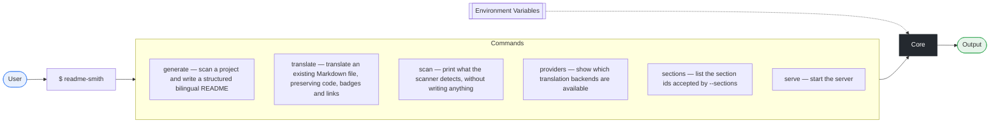
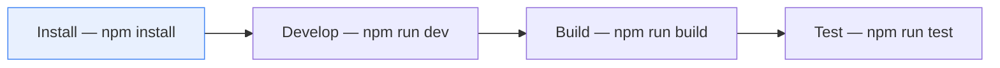

# Readme Smith

<p align="center">**English** | [中文](./README.zh-CN.md)</p>

<p align="center">Scan any repository and forge a structured, badge-rich, diagram-rich bilingual README in English and Simplified Chinese.</p>

<p align="center">=18.17" />    </p>

## Highlights
- **What it does** — Scan any repository and forge a structured, badge-rich, diagram-rich bilingual README in English and Simplified Chinese.
- **Why it exists** — Good code from non-native English writers loses readers at the README. Written by hand in a second language, it ends up thin: no badges, no diagrams, no working install step, and a Chinese file that drifts away from the English one a month later.
- **When to reach for it** — Before publishing a repository, before a release, or whenever a README has fallen behind the code. It is useful with no API key at all; a key only buys prose translation.
- **Why you can keep it** — Regenerating never destroys what you wrote: your own words live in `.readme-smith/<section>.<lang>.md` and replace only the body of a section, so the table of contents and the language switcher stay in step. These three lines came from such a file.

## Table of Contents

- [Highlights](#highlights)
- [Features](#features)
- [Architecture](#architecture)
- [Quick Start](#quick-start)
- [Installation](#installation)
  - [Requirements](#requirements)
  - [From source](#from-source)
- [Usage](#usage)
- [Commands](#commands)
- [Environment Variables](#environment-variables)
- [Available Scripts](#available-scripts)
- [Project Structure](#project-structure)
- [Dependencies](#dependencies)
- [Languages](#languages)
- [Development](#development)
- [Testing](#testing)
- [Roadmap](#roadmap)
- [Contributing](#contributing)
- [Contributors](#contributors)
- [FAQ](#faq)
  - [How is this different from similar tools?](#how-is-this-different-from-similar-tools)
  - [How do I keep the README from falling behind the code?](#how-do-i-keep-the-readme-from-falling-behind-the-code)
  - [Why would `--check` fail on a checkout with `core.autocrlf=true`?](#why-would---check-fail-on-a-checkout-with-coreautocrlftrue)
  - [Is this production ready?](#is-this-production-ready)
- [License](#license)
- [Project Stats](#project-stats)

## Features
- Scriptable CLI with 7 commands
- Fully typed — first-class TypeScript support
- Internationalised, with translations built in
- Cross-platform — runs on macOS, Linux and Windows
- Built on **Commander**

## Architecture


## Quick Start
1. Run it

   ```bash
   readme-smith generate
   ```

## Installation
### Requirements
| Runtime | Version |
| --- | --- |
| `node` | `>=18.17` |

### From source
```bash
git clone https://gitee.com/yuwan41064/readme-smith.git
cd readme-smith
npm install
```

## Usage
Run the CLI:

```bash
readme-smith --help
readme-smith generate --help
```

## Commands
| Command | Description | Flags |
| --- | --- | --- |
| `generate` | scan a project and write a structured bilingual README | `-l, --lang <langs>` `-o, --out <dir>` `--filename <name>` `--stdout` `--json` `--no-badges` `--no-diagrams` `--no-toc` `--no-switcher` `--badge-style <style>` `--sections <list>` `--tree-depth <n>` `-f, --force` `--no-backup` `--dry-run` `--check` `--skip-git` `--translate-prose` `--provider <id>` `--unpublished` |
| `translate` | translate an existing Markdown file, preserving code, badges and links | `--from <lang>` `--to <lang>` `--provider <id>` `-o, --out <file>` `--stdout` `--concurrency <n>` `--instruction <text>` `--preserve <terms>` `-f, --force` |
| `scan` | print what the scanner detects, without writing anything | `--json` `--skip-git` |
| `providers` | show which translation backends are available | — |
| `sections` | list the section ids accepted by --sections | — |
| `serve` | start the server | `-p, --port <n>` `--log <level>` |
| `watch` | restart on change | `--flag-${i} <v>` |

## Environment Variables
The following environment variables can be set in your shell or a `.env` file:

| Variable | Description | Required |
| --- | --- | --- |
| `README_SMITH_LLM_BASE_URL` | — | optional |
| `README_SMITH_LLM_MODEL` | — | optional |
| `README_SMITH_LLM_API_KEY` | — | optional |
| `MYMEMORY_EMAIL` | — | optional |
| `OPENAI_BASE_URL` | — | optional |
| `OPENAI_MODEL` | — | optional |
| `README_SMITH_DEBUG` | — | optional |
| `README_SMITH_DISABLE_GOOGLE` | — | optional |
| `README_SMITH_DISABLE_MYMEMORY` | — | optional |

> **Note** · The description column is intentionally blank — fill in what each variable does and its default.

## Available Scripts
| Command | Category | Underlying command |
| --- | --- | --- |
| `npm run build` | Build | `tsc -p tsconfig.json` |
| `npm run dev` | Development | `tsc -p tsconfig.json --watch` |
| `npm run clean` | Other | `node -e "fs.rmSync('dist',{recursive:true,force:true})"` |
| `npm run typecheck` | Other | `tsc -p tsconfig.json --noEmit` |
| `npm run test` | Test | `node --test "dist/**/*.test.js"` |
| `npm run prepublishOnly` | Other | `npm run clean && npm run build` |
| `npm run forge:self` | Other | `node dist/cli.js generate . --lang en,zh --force --unpublished` |

## Project Structure
```text
readme-forge/
├── src/   # source code
│   ├── generate/
│   │   ├── badges.ts
│   │   ├── index.ts
│   │   ├── markdown.ts
│   │   ├── mermaid.test.ts
│   │   ├── mermaid.ts
│   │   ├── overrides.test.ts
│   │   ├── overrides.ts
│   │   └── sections.ts
│   ├── i18n/   # translations
│   │   ├── providers/
│   │   │   ├── deepl.ts
│   │   │   ├── free.ts
│   │   │   ├── index.ts
│   │   │   ├── llm.test.ts
│   │   │   └── llm.ts
│   │   ├── dict.ts
│   │   ├── glossary.ts
│   │   ├── index.ts
│   │   ├── markdown.ts
│   │   └── provider.ts
│   ├── scanner/
│   │   ├── cli-detect.test.ts
│   │   ├── cli-detect.ts
│   │   ├── features.ts
│   │   ├── index.ts
│   │   ├── languages.ts
│   │   ├── manifests.ts
│   │   └── structure.ts
│   ├── utils/   # helpers
│   │   ├── fs.ts
│   │   ├── git.ts
│   │   ├── logger.ts
│   │   └── toml.ts
│   ├── cli.test.ts
│   ├── cli.ts
│   ├── index.ts
│   └── types.ts
├── .readme-smith/   # hand-written README sections
│   ├── faq.en.md
│   ├── faq.zh.md
│   ├── highlights.en.md
│   ├── highlights.zh.md
│   ├── roadmap.en.md
│   └── roadmap.zh.md
├── README.md   # project overview
├── README.zh-CN.md   # project overview (中文)
├── LICENSE   # license terms
├── package.json   # dependencies & scripts
├── tsconfig.json   # TypeScript config
├── .gitattributes
└── .gitignore   # git ignore rules
```

Key entry points:

- `dist/index.js`
- `dist/index.d.ts`
- `src/index.ts`
- `src/cli.ts`

## Dependencies
<details open>
<summary>Runtime dependencies (1)</summary>

| Package | Version |
| --- | --- |
| `commander` | `^12.1.0` |

</details>

<details>
<summary>Development dependencies (2)</summary>

| Package | Version |
| --- | --- |
| `@types/node` | `^22.10.0` |
| `typescript` | `^5.7.0` |

</details>

## Languages
| Language | Share | Files | Lines |
| --- | ---: | ---: | ---: |
| TypeScript | 99.4% | 33 | 6.8k |
| Markdown | 0.6% | 6 | — |

## Development


Get a development environment running:

1. Clone the repository

   ```bash
   git clone https://gitee.com/yuwan41064/readme-smith.git
   ```

2. Install dependencies

   ```bash
   npm install
   ```

3. Start the development workflow

   ```bash
   npm run dev
   ```

4. Build for production

   ```bash
   npm run build
   ```

5. Run the test suite

   ```bash
   npm run test
   ```

Work on a feature branch and open a pull request when ready.

## Testing
This project ships an automated test suite.

Run all tests:

```bash
npm run test
```

## Roadmap
- [x] Scanner for 14 package ecosystems, gitignore-aware, no execution of scanned code
- [x] Badges and Mermaid diagrams derived only from facts found in the repository
- [x] Markdown-aware translation that leaves code, links and diagrams untouched
- [x] Hand-written section bodies in `.readme-smith/` survive the next run
- [ ] Publish the package so `npm install -g readme-smith` works
- [ ] Verify registry and CI claims against the live services instead of inferring them from the manifest
- [ ] More output languages, and a plugin API for third-party translation providers
- [x] A `--check` mode for CI that fails when a README no longer matches the code
- [ ] Report a byte size that does not depend on how the checkout chose its line endings

## Contributing
Contributions are what make the open source community such an amazing place to learn, inspire, and create. Any contribution you make is **greatly appreciated**.

Ways you can help:

- Report bugs and request features by opening an issue
- Submit a pull request — small fixes are just as welcome as features
- Improve or translate the documentation
- Share the project and give it a star if it helped you

> **Heads up** · There is no contribution guide yet — opening an issue is the best way to start a conversation about a change.

[Report a bug / request a feature](https://gitee.com/yuwan41064/readme-smith/issues)

## Contributors
Thanks to everyone who has contributed:

| Contributor | Commits |
| --- | ---: |
| yuwan41064 | 1 |

## FAQ
### How is this different from similar tools?
Most generators hand you a skeleton full of placeholder prose and a single language. Every badge, diagram and command here is derived from a fact the scanner actually found in your repository, and a claim it cannot verify is left out rather than guessed at. The output is two files in the same shape, so the English and the Simplified Chinese README cannot drift apart.

### How do I keep the README from falling behind the code?
Put `readme-smith generate --check` in CI with the same options you generate with. It renders the documents, compares them with the files on disk and exits non-zero on the first line where they stop agreeing, without writing anything. `generate` itself now re-renders until the document describes the files it just wrote, so the file it leaves behind passes the check immediately.

### Why would `--check` fail on a checkout with `core.autocrlf=true`?
The document reports the repository's size in bytes, and the same commit checked out with CRLF really is bigger. Pin line endings once with a `.gitattributes` (`* text=auto eol=lf`) and every machine agrees. The README's own line endings are never counted as drift.

### Is this production ready?
The translation provider layer, the Markdown list renderer and the `generate`/`--check` round trip have regression tests, the last of them by running the compiled CLI against temporary repositories. The command-line detector is tested as well; most of the scanner's other heuristics are not, so an unusual project layout can still be misread. Treat the output as a well-structured first draft: review it, replace the prompts it marks for you, then commit. Registry and CI claims need `--unpublished` or a real remote to be truthful, and the package itself is not published yet, so install it from source.

## License
Distributed under the MIT license. See [LICENSE](https://opensource.org/licenses/MIT) for more information.

## Project Stats
<details>
<summary>Statistics for `readme-smith`</summary>

| Metric | Value |
| --- | ---: |
| Files scanned | 46 |
| Lines of code | 6.8k |
| Source size | 381 KB |
| Directories | 8 |
| Dependencies | 3 |
| Contributors | 1 |
| Languages | TypeScript 99% · Markdown 1% |

</details>

<hr />

<p align="center">Generated by **readme-smith** from the repository contents</p>
