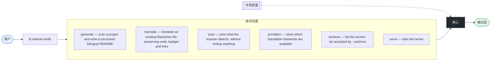
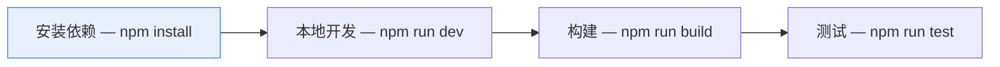

# Readme Smith

<p align="center">[English](./README.md) | **中文**</p>

<p align="center">Scan any repository and forge a structured, badge-rich, diagram-rich bilingual README in English and Simplified Chinese.</p>

<p align="center">=18.17" />    </p>

## 项目亮点
- **它做什么** —— 读取仓库里的真实信息，生成英文与简体中文两份结构一致的 README，包含徽章、Mermaid 图和可复制的安装命令。
- **为什么存在** —— 非英语母语的作者写不出地道英文文档，代码再好也在 README 这一关流失读者；手写第二语言文档通常只剩干巴巴几句：没有徽章、没有图、安装命令跑不通，中文那份还会在一个月后和英文版对不上。
- **何时使用** —— 首次开源仓库时、发版前，或者 README 已经落后于代码时。不配任何 API Key 也能用，Key 只影响正文翻译。
- **为什么能长期拥有它** —— 重新生成不会冲掉你写的字：你自己的话放在 `.readme-smith/<章节>.<语言>.md` 里，只替换某一节的正文，目录和语言切换链接仍由工具维护。上面这几行就是从这样一个文件里读出来的。

## 目录

- [项目亮点](#项目亮点)
- [功能特性](#功能特性)
- [架构设计](#架构设计)
- [快速开始](#快速开始)
- [安装](#安装)
  - [环境要求](#环境要求)
  - [从源码安装](#从源码安装)
- [使用方法](#使用方法)
- [命令列表](#命令列表)
- [环境变量](#环境变量)
- [可用脚本](#可用脚本)
- [项目结构](#项目结构)
- [依赖](#依赖)
- [语言构成](#语言构成)
- [本地开发](#本地开发)
- [测试](#测试)
- [路线图](#路线图)
- [参与贡献](#参与贡献)
- [贡献者](#贡献者)
- [常见问题](#常见问题)
  - [它和同类工具有什么区别？](#它和同类工具有什么区别)
  - [怎么防止 README 落后于代码？](#怎么防止-readme-落后于代码)
  - [为什么在 `core.autocrlf=true` 的检出上 `--check` 会失败？](#为什么在-coreautocrlftrue-的检出上---check-会失败)
  - [可以用于生产环境吗？](#可以用于生产环境吗)
- [许可证](#许可证)
- [项目数据](#项目数据)

## 功能特性
- 可脚本化的命令行接口，共 7 条命令
- 完整类型定义，原生支持 TypeScript
- 内置国际化支持
- 跨平台，支持 macOS、Linux 与 Windows
- 技术栈：**Commander**

## 架构设计


## 快速开始
1. 运行它

   ```bash
   readme-smith generate
   ```

## 安装
### 环境要求
| 运行时 | 版本要求 |
| --- | --- |
| `node` | `>=18.17` |

### 从源码安装
```bash
git clone https://gitee.com/yuwan41064/readme-smith.git
cd readme-smith
npm install
```

## 使用方法
运行命令行工具：

```bash
readme-smith --help
readme-smith generate --help
```

## 命令列表
| 命令 | 说明 | 参数 |
| --- | --- | --- |
| `generate` | scan a project and write a structured bilingual README | `-l, --lang <langs>` `-o, --out <dir>` `--filename <name>` `--stdout` `--json` `--no-badges` `--no-diagrams` `--no-toc` `--no-switcher` `--badge-style <style>` `--sections <list>` `--tree-depth <n>` `-f, --force` `--no-backup` `--dry-run` `--check` `--skip-git` `--translate-prose` `--provider <id>` `--unpublished` |
| `translate` | translate an existing Markdown file, preserving code, badges and links | `--from <lang>` `--to <lang>` `--provider <id>` `-o, --out <file>` `--stdout` `--concurrency <n>` `--instruction <text>` `--preserve <terms>` `-f, --force` |
| `scan` | print what the scanner detects, without writing anything | `--json` `--skip-git` |
| `providers` | show which translation backends are available | — |
| `sections` | list the section ids accepted by --sections | — |
| `serve` | start the server | `-p, --port <n>` `--log <level>` |
| `watch` | restart on change | `--flag-${i} <v>` |

## 环境变量
以下环境变量可通过 shell 环境或 `.env` 文件设置：

| 变量 | 说明 | 是否必需 |
| --- | --- | --- |
| `README_SMITH_LLM_BASE_URL` | — | 可选 |
| `README_SMITH_LLM_MODEL` | — | 可选 |
| `README_SMITH_LLM_API_KEY` | — | 可选 |
| `MYMEMORY_EMAIL` | — | 可选 |
| `OPENAI_BASE_URL` | — | 可选 |
| `OPENAI_MODEL` | — | 可选 |
| `README_SMITH_DEBUG` | — | 可选 |
| `README_SMITH_DISABLE_GOOGLE` | — | 可选 |
| `README_SMITH_DISABLE_MYMEMORY` | — | 可选 |

> **提示** · 「说明」一列留空，请补充每个变量的含义与默认值。

## 可用脚本
| 命令 | 分类 | 实际命令 |
| --- | --- | --- |
| `npm run build` | 构建 | `tsc -p tsconfig.json` |
| `npm run dev` | 开发 | `tsc -p tsconfig.json --watch` |
| `npm run clean` | 其他 | `node -e "fs.rmSync('dist',{recursive:true,force:true})"` |
| `npm run typecheck` | 其他 | `tsc -p tsconfig.json --noEmit` |
| `npm run test` | 测试 | `node --test "dist/**/*.test.js"` |
| `npm run prepublishOnly` | 其他 | `npm run clean && npm run build` |
| `npm run forge:self` | 其他 | `node dist/cli.js generate . --lang en,zh --force --unpublished` |

## 项目结构
```text
readme-forge/
├── src/   # 源码
│   ├── generate/
│   │   ├── badges.ts
│   │   ├── index.ts
│   │   ├── markdown.ts
│   │   ├── mermaid.test.ts
│   │   ├── mermaid.ts
│   │   ├── overrides.test.ts
│   │   ├── overrides.ts
│   │   └── sections.ts
│   ├── i18n/   # 多语言文案
│   │   ├── providers/
│   │   │   ├── deepl.ts
│   │   │   ├── free.ts
│   │   │   ├── index.ts
│   │   │   ├── llm.test.ts
│   │   │   └── llm.ts
│   │   ├── dict.ts
│   │   ├── glossary.ts
│   │   ├── index.ts
│   │   ├── markdown.ts
│   │   └── provider.ts
│   ├── scanner/
│   │   ├── cli-detect.test.ts
│   │   ├── cli-detect.ts
│   │   ├── features.ts
│   │   ├── index.ts
│   │   ├── languages.ts
│   │   ├── manifests.ts
│   │   └── structure.ts
│   ├── utils/   # 工具函数
│   │   ├── fs.ts
│   │   ├── git.ts
│   │   ├── logger.ts
│   │   └── toml.ts
│   ├── cli.test.ts
│   ├── cli.ts
│   ├── index.ts
│   └── types.ts
├── .readme-smith/   # 人工撰写的 README 章节
│   ├── faq.en.md
│   ├── faq.zh.md
│   ├── highlights.en.md
│   ├── highlights.zh.md
│   ├── roadmap.en.md
│   └── roadmap.zh.md
├── README.md   # 项目说明
├── README.zh-CN.md   # 中文项目说明
├── LICENSE   # 许可证条款
├── package.json   # 依赖与脚本
├── tsconfig.json   # TypeScript 配置
├── .gitattributes
└── .gitignore   # git 忽略规则
```

主要入口文件：

- `dist/index.js`
- `dist/index.d.ts`
- `src/index.ts`
- `src/cli.ts`

## 依赖
<details open>
<summary>运行时依赖 (1)</summary>

| 依赖包 | 版本 |
| --- | --- |
| `commander` | `^12.1.0` |

</details>

<details>
<summary>开发依赖 (2)</summary>

| 依赖包 | 版本 |
| --- | --- |
| `@types/node` | `^22.10.0` |
| `typescript` | `^5.7.0` |

</details>

## 语言构成
| 语言 | 占比 | 文件数 | 代码行数 |
| --- | ---: | ---: | ---: |
| TypeScript | 99.4% | 33 | 6.8k |
| Markdown | 0.6% | 6 | — |

## 本地开发


搭建本地开发环境：

1. 克隆仓库

   ```bash
   git clone https://gitee.com/yuwan41064/readme-smith.git
   ```

2. 安装依赖

   ```bash
   npm install
   ```

3. 启动开发流程

   ```bash
   npm run dev
   ```

4. 构建生产产物

   ```bash
   npm run build
   ```

5. 运行测试

   ```bash
   npm run test
   ```

请在特性分支上开发，完成后提交 Pull Request。

## 测试
本项目包含自动化测试套件。

运行全部测试：

```bash
npm run test
```

## 路线图
- [x] 覆盖 14 种包生态的扫描器，遵守 .gitignore，绝不执行被扫描项目的代码
- [x] 徽章与 Mermaid 图只来自仓库中确实存在的事实
- [x] 理解 Markdown 语法的翻译层，代码块、链接和图都不会被改动
- [x] `.readme-smith/` 里人工撰写的章节，下次生成时不会被冲掉
- [ ] 正式发布，让 `npm install -g readme-smith` 真正可用
- [ ] 在线校验 registry 与 CI 声明，而不是仅凭 manifest 推断
- [ ] 更多输出语言，以及供第三方翻译服务接入的插件接口
- [x] 面向 CI 的 `--check` 模式，README 与代码不一致时直接失败
- [ ] 让报告的字节体积不受检出时行尾符影响

## 参与贡献
正是社区的贡献让开源成为学习与创造的绝佳场所。任何形式的贡献我们都**不胜感激**。

你可以通过以下方式参与：

- 提交 Issue，报告缺陷或提出功能建议
- 提交 Pull Request —— 小修复与新功能同样欢迎
- 改进或翻译文档
- 分享本项目，如果它帮到了你，请给它一个 Star

> **注意** · 目前还没有贡献指南 —— 想讨论某项改动，最好的方式是先开一个 Issue。

[报告问题 / 提出建议](https://gitee.com/yuwan41064/readme-smith/issues)

## 贡献者
感谢所有贡献者的付出：

| 贡献者 | 提交数 |
| --- | ---: |
| yuwan41064 | 1 |

## 常见问题
### 它和同类工具有什么区别？
多数生成器给你的是一堆占位文字的空壳，而且只有一种语言。这里每一枚徽章、每张图、每条命令都来自扫描器在你仓库里真正找到的事实，无法核实的信息宁可不写。输出是结构完全对应的两份文件，中英文 README 不会各自漂移。

### 怎么防止 README 落后于代码？
在 CI 里跑 `readme-smith generate --check`，带上与生成时相同的选项。它只渲染、不写盘，把结果与磁盘上的文件逐行比对，在第一个不一致的行停下并以非零状态退出。`generate` 现在会反复重渲染，直到文档描述的就是它自己刚写出的那些文件，所以它留下的文件当场就能通过检查。

### 为什么在 `core.autocrlf=true` 的检出上 `--check` 会失败？
文档会报告仓库的字节体积，而同一个提交用 CRLF 检出确实更大。用 `.gitattributes`（`* text=auto eol=lf`）一次性固定行尾，各台机器就能保持一致。README 自身的行尾差异从来不会被当成不一致。

### 可以用于生产环境吗？
翻译服务层、Markdown 列表渲染，以及 `generate` 与 `--check` 的往返一致性都有回归测试，最后这组测试是直接拿编译好的 CLI 去操作临时仓库跑的。命令行识别那部分也测了；扫描器其余的启发式规则大多没有单独的测试，少见的仓库结构仍可能读错。请把产物当成一份结构良好的初稿：先审一遍，把标注「请替换」的地方写成你自己的话，再提交。registry 与 CI 声明需要配合 `--unpublished` 或真实远程仓库才谈得上准确；本项目自身尚未发布，请从源码安装。

## 许可证
本项目基于 MIT 许可证发布，详见 [LICENSE](https://opensource.org/licenses/MIT)。

## 项目数据
<details>
<summary>`readme-smith` 的统计数据</summary>

| 指标 | 数值 |
| --- | ---: |
| 扫描文件数 | 46 |
| 代码行数 | 6.8k |
| 源码体积 | 381 KB |
| 目录数 | 8 |
| 依赖数量 | 3 |
| 贡献者 | 1 |
| 语言构成 | TypeScript 99% · Markdown 1% |

</details>

<hr />

<p align="center">由 **readme-smith** 根据仓库内容自动生成</p>
